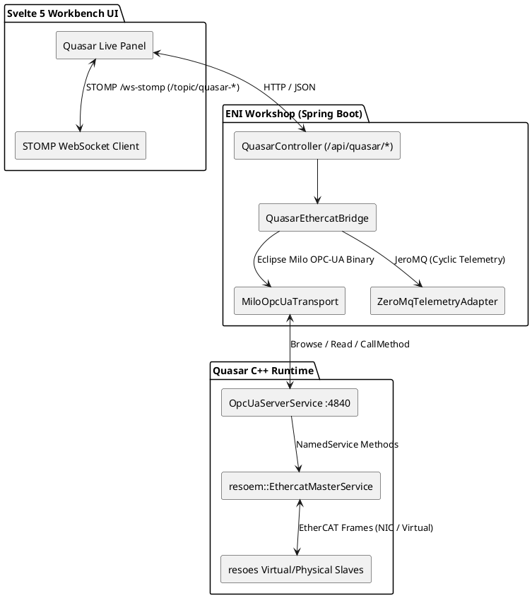

# Quasar (`resoem` / `resoes`) Integration Architecture

This document defines how **ENI Workshop** integrates with **Quasar** (`OpcUaServerService`, `resoem::EthercatMasterService`, and `resoes`), following the architecture established in **Nunki** (`OPCUA-Integration.md`).

---

## System Topology

---

## Exposed `resoem::EthercatMasterService` Methods

Quasar's `resoem::EthercatMasterService` exposes the following `NamedMethod` / `NamedObject` entries via `OpcUaServerService`:

| Method | Parameters (JSON) | Purpose in ENI Workshop |
| :--- | :--- | :--- |
| `refreshStatus` | `{}` | Refresh live slave ESM states, AL Status codes, and working counters |
| `forceInit` | `{}` | Command all EtherCAT slaves to `INIT` state |
| `reconfigureSlave` | `{"slaveIndex": N}` | Re-apply InitCmds and SyncManagers to slave `N` |
| `loadEni` | `{"filepath": "..."}` | Push an ENI XML configuration to Quasar's `EniConfigurator` for live execution/testing |
| `exportEni` | `{"masterName": "..."}` | Trigger `EniGenerator` bus scan and return an ETG.2100 ENI XML topology |
| `compareEni` | `{"filepath": "..."}` | Run `EniComparator` against the live bus and report mismatches |

---

## `quasar_server/` C++ Helper

Following Nunki's `quasar_server/` pattern, ENI Workshop includes `quasar_server/` containing a CMake C++23 executable linking Quasar's `opcua`, `named`, `resoem`, and `resoes` libraries to expose both physical NIC and virtual `resoes` EtherCAT test loops over OPC-UA port `4840`.
